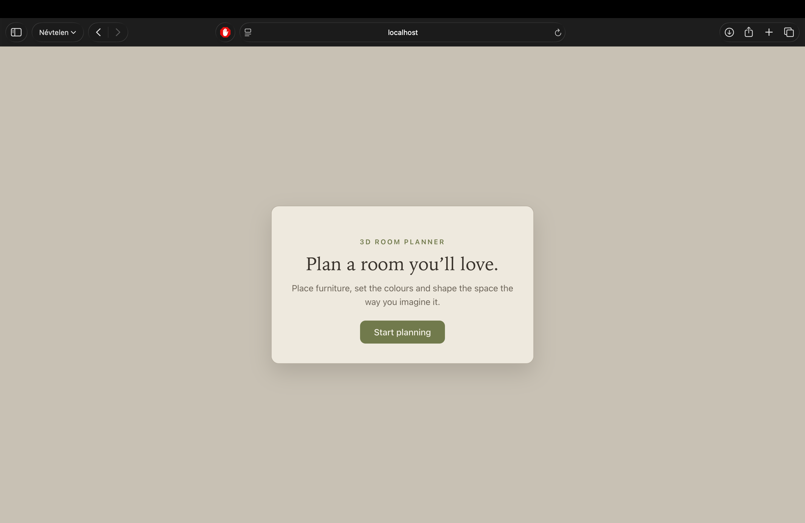
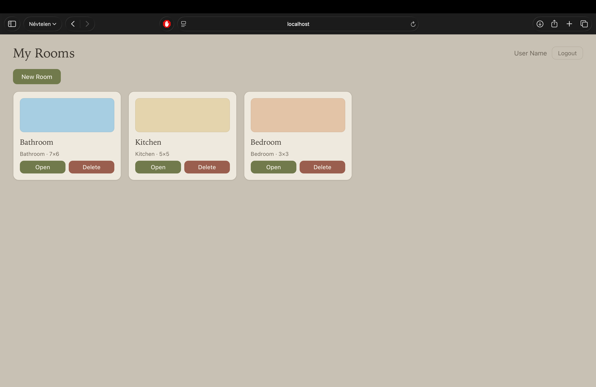
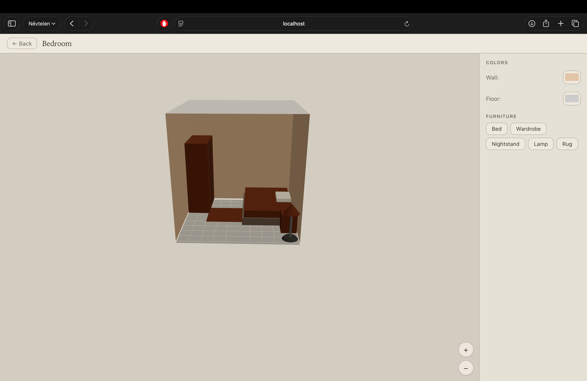
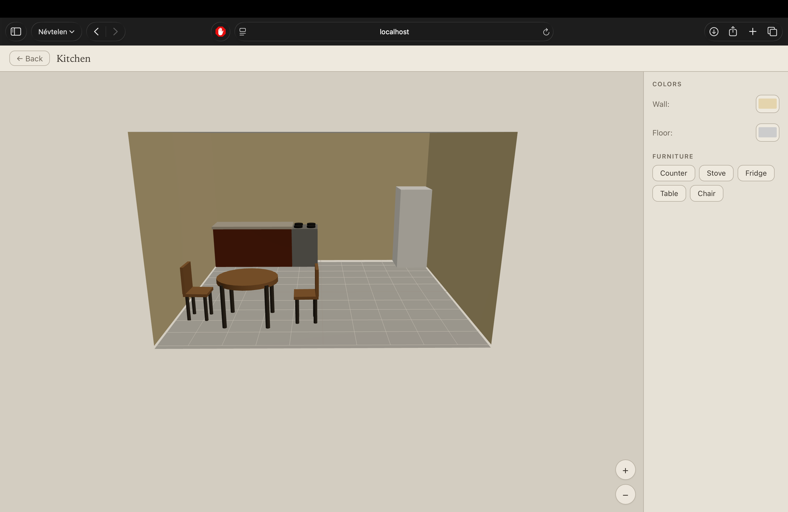
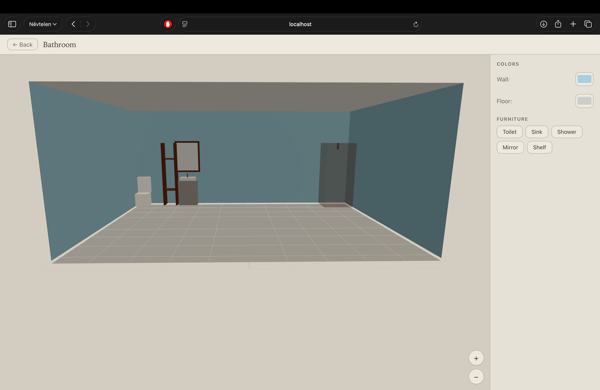

# 3D Room Designer

A web-based 3D interior design application built with React, Three.js, and Node.js.

## Features

- 3D room with customizable wall, floor, and ceiling colors
- Furniture catalog with drag & drop placement
- Color customization for each furniture piece
- Save and load room configurations
- User authentication (register/login)

## Screenshots








## Tech Stack

**Frontend:** React, TypeScript, Three.js (React Three Fiber + Drei), Vite
**Backend:** Node.js, Express, JavaScript, MySQL
**Auth:** JWT, bcrypt

## Setup

### 1. Database

Import `room_designer.sql` into your MySQL database (XAMPP phpMyAdmin):

1. Start XAMPP → Start MySQL
2. Open http://localhost/phpmyadmin
3. Import → Select `room_designer.sql`

> If the table **already exists** (from an earlier version), run this SQL in the
> phpMyAdmin **SQL** tab instead of importing:
>
> ```sql
> ALTER TABLE rooms
>   ADD COLUMN room_type VARCHAR(20) NOT NULL DEFAULT 'bedroom',
>   ADD COLUMN width FLOAT NOT NULL DEFAULT 5,
>   ADD COLUMN length FLOAT NOT NULL DEFAULT 5;
> ```

### 2. Backend

```bash
cd backend
cp .env.example .env   # then edit .env with your values
npm install
npm run dev
```

The server starts on http://localhost:3000.

### 3. Frontend

```bash
cd frontend
npm install
npm run dev
```

The app opens on http://localhost:5173.

## API Endpoints

| Method | Endpoint | Auth | Description |
|--------|----------|------|-------------|
| POST | /api/auth/register | No | Register |
| POST | /api/auth/login | No | Login |
| GET | /api/auth/me | Yes | Profile |
| GET | /api/rooms | Yes | List rooms |
| POST | /api/rooms | Yes | Create room |
| GET | /api/rooms/:id | Yes | Get room with furniture |
| PUT | /api/rooms/:id | Yes | Update room |
| DELETE | /api/rooms/:id | Yes | Delete room |
| POST | /api/rooms/:id/furniture | Yes | Add furniture |
| PUT | /api/rooms/:id/furniture/:fid | Yes | Update furniture |
| DELETE | /api/rooms/:id/furniture/:fid | Yes | Remove furniture |
